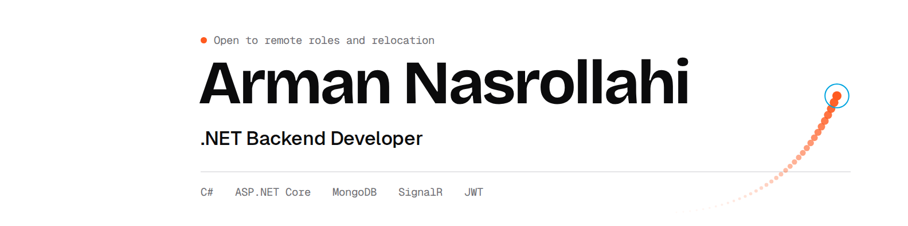

<picture>
  <source media="(prefers-color-scheme: dark)" srcset="assets/linkedin_banner_dark.png">
  
</picture>

## Hi, I'm Arman.

I'm a backend developer building APIs, payment integrations and real-time systems with **C#** and **ASP.NET Core**. Since 2023 I've worked on production products in education, fintech, fitness, e-commerce and enterprise ERP.

I care about clean structure, readable code and how a system behaves after it ships.

---

### What I work with

| | |
|---|---|
| **Languages & frameworks** | C#, .NET, ASP.NET Core, REST APIs |
| **Data** | MongoDB (schema design, indexing, aggregation), SQL Server |
| **Architecture** | Clean Architecture, Repository-Service, SOLID, Dependency Injection |
| **Auth & real-time** | JWT, role-based access control, SignalR |
| **Integrations** | Payment gateways, SMS, MailKit, S3 |
| **Tools** | Git, Docker, Swagger/OpenAPI, Postman |

---

### Featured

- **[PersianDateTimeHelper](https://github.com/ArmanNS1/PersianDateTimeHelper)**: a .NET library for Persian (Jalali) calendar logic, published on NuGet. Date conversion, holiday detection, working-hours and overtime calculations, with unit tests and ASP.NET Core DI support.
- **[Add your flagship repo here]**: a one-line description of what it shows.
- **[Basic_UserService_API](https://github.com/ArmanNS1/Basic_UserService_API)**: a user service API with MongoDB.

---

### Right now

- Building: [what you're working on]
- Learning: [for example Kubernetes, gRPC]
- Writing: posts about .NET backend work on LinkedIn

---

### Find me

[Portfolio](https://arman-portfolio-inky-xi.vercel.app/en/) · [LinkedIn](https://www.linkedin.com/in/arman-nasrollahi) · [Email](mailto:ns1armandev@gmail.com)
